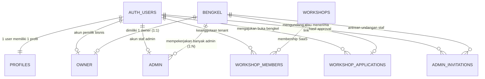
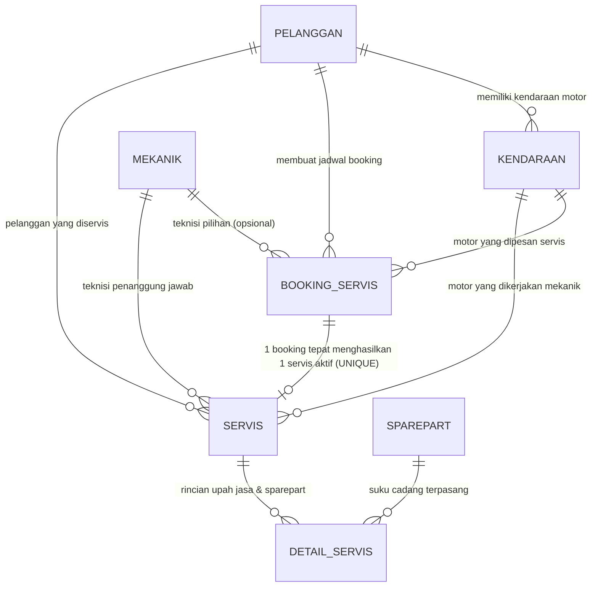
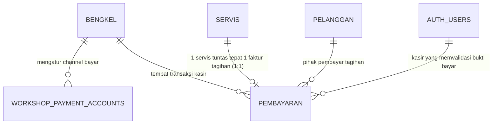
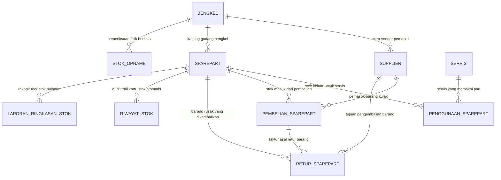
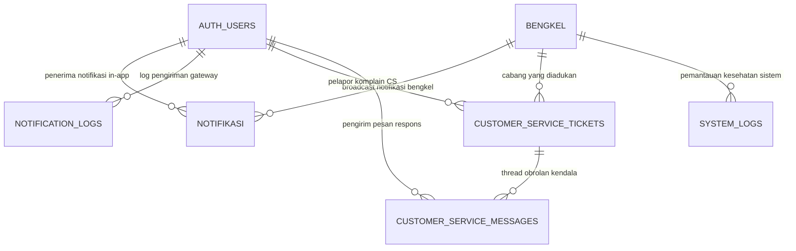

# 📑 DOKUMEN RESMI DIAGRAM ENTITY RELATIONSHIP (ERD)
## Sistem Manajemen Bengkel Motor Terpadu (AppBenk - Pitstop Pro Hub)
**Dokumen Pembuktian Arsitektur Basis Data & Integritas Relasional**  
*Tanggal Rilis: 30 September 2026 | Versi 2.4 (Production Live)*

---

### 📌 Ringkasan Eksekutif Arsitektur
Dokumen ini disusun sebagai **bukti formal arsitektur basis data relasional (ERD)** pada aplikasi **AppBenk (Pitstop Pro Hub)**. Arsitektur ini dibangun di atas mesin database **PostgreSQL (Supabase Cloud)** dengan menerapkan pola **Multi-Tenant Software as a Service (SaaS)**, **Row Level Security (RLS)**, serta **Integritas Constraint Anti-Duplikasi**.

Basis data terdiri dari **30 Entitas (1 Core Auth + 29 Public Tables)** yang terbagi ke dalam 5 subsistem fungsional terintegrasi:
1. **Core SaaS & Identity Access Management (IAM)**: Multi-tenancy isolasi bengkel, perizinan role bertingkat (Super Admin, Owner, Admin, Mekanik, Pelanggan).
2. **Pelanggan, Armada & Operasional Servis**: Alur reservasi booking online dan pelaksanaan servis fisik di bengkel dengan **Constraint Unik 1 Booking = Tepat 1 Servis Aktif**.
3. **Finansial, Kasir & Multi-Payment**: Transaksi kasir tunai, transfer bank manual, dan verifikasi QRIS statis/dinamis.
4. **Supply Chain, Gudang & Logistik**: Katalog sparepart, mutasi kartu stok real-time, pengadaan supplier, stok opname, dan retur barang cacat.
5. **Pusat Pengaduan CS, Notifikasi Realtime & System Audit**: Layanan komplain terpusat anti-spoofing, notifikasi push in-app, gateway log, dan logging error sistem.

---

## 1. 🌐 Master ERD Lengkap (Consolidated Full Schema)

Diagram berikut merangkum seluruh keterhubungan 30 entitas database dalam satu kanvas utuh:

```mermaid
erDiagram

    %% =========================================================================
    %% 1. HUBUNGAN CORE MULTI-TENANT & AUTENTIKASI
    %% =========================================================================
    AUTH_USERS ||--|| PROFILES : "1-to-1 profil pengguna"
    AUTH_USERS ||--o| OWNER : "1-to-1 akun owner bengkel"
    AUTH_USERS ||--o| ADMIN : "1-to-1 akun staf admin bengkel"
    AUTH_USERS ||--o| PELANGGAN : "1-to-1 akun konsumen (opsional login)"
    AUTH_USERS ||--o{ WORKSHOP_MEMBERS : "keanggotaan multi-tenant"
    AUTH_USERS ||--o{ WORKSHOP_APPLICATIONS : "pemohon registrasi bengkel"
    AUTH_USERS ||--o{ ADMIN_INVITATIONS : "pembuat/pengklaim undangan staf"
    AUTH_USERS ||--o{ NOTIFIKASI : "penerima pesan notifikasi in-app"
    AUTH_USERS ||--o{ NOTIFICATION_LOGS : "target pengiriman notifikasi"
    AUTH_USERS ||--o{ PEMBAYARAN : "kasir verifikator pembayaran"
    AUTH_USERS ||--o{ CUSTOMER_SERVICE_TICKETS : "pelapor komplain CS"
    AUTH_USERS ||--o{ CUSTOMER_SERVICE_MESSAGES : "pengirim respons tiket CS"

    BENGKEL ||--o| OWNER : "dimiliki tepat 1 akun owner"
    BENGKEL ||--o{ ADMIN : "mempekerjakan banyak admin"
    BENGKEL ||--o{ MEKANIK : "memiliki daftar teknisi bengkel"
    BENGKEL ||--o{ SUPPLIER : "mitra vendor suku cadang"
    BENGKEL ||--o{ BOOKING_SERVIS : "menerima reservasi pelanggan"
    BENGKEL ||--o{ SERVIS : "pelaksanaan pengerjaan servis"
    BENGKEL ||--o{ PEMBELIAN_SPAREPART : "transaksi pengadaan dari supplier"
    BENGKEL ||--o{ RETUR_SPAREPART : "pengembalian suku cadang rusak"
    BENGKEL ||--o{ STOK_OPNAME : "pemeriksaan fisik inventaris"
    BENGKEL ||--o{ WORKSHOP_PAYMENT_ACCOUNTS : "metode rekening & QRIS resmi"
    BENGKEL ||--o{ NOTIFIKASI : "notifikasi aktivitas operasional"
    BENGKEL ||--o{ CUSTOMER_SERVICE_TICKETS : "tiket CS terkait cabang bengkel"
    BENGKEL ||--o{ ADMIN_INVITATIONS : "antrean token undangan staf"
    BENGKEL ||--o{ SYSTEM_LOGS : "rekam jejak kesehatan sistem bengkel"
    BENGKEL ||--o| WORKSHOP_APPLICATIONS : "hasil persetujuan pendaftaran"

    WORKSHOPS ||--o{ WORKSHOP_MEMBERS : "membership workspace SaaS"
    WORKSHOPS ||--o{ WORKSHOP_PAYMENT_ACCOUNTS : "rekening pembayaran tenant"
    WORKSHOPS ||--o{ NOTIFICATION_LOGS : "log notifikasi tenant"

    %% =========================================================================
    %% 2. HUBUNGAN PELANGGAN & ARMADA KENDARAAN
    %% =========================================================================
    PELANGGAN ||--o{ KENDARAAN : "memiliki 1 atau banyak motor"
    PELANGGAN ||--o{ BOOKING_SERVIS : "melakukan pemesanan booking"
    PELANGGAN ||--o{ SERVIS : "menerima layanan servis fisik"
    PELANGGAN ||--o{ PEMBAYARAN : "membayar tagihan transaksi"
    PELANGGAN ||--o{ CUSTOMER_SERVICE_TICKETS : "mengajukan tiket bantuan"

    KENDARAAN ||--o{ BOOKING_SERVIS : "objek kendaraan yang dibooking"
    KENDARAAN ||--o{ SERVIS : "objek kendaraan yang diservis"

    %% =========================================================================
    %% 3. HUBUNGAN OPERASIONAL SERVIS & TRANSAKSI KASIR
    %% =========================================================================
    MEKANIK ||--o{ BOOKING_SERVIS : "teknisi pilihan (opsional)"
    MEKANIK ||--o{ SERVIS : "teknisi penanggung jawab pengerjaan"

    BOOKING_SERVIS ||--o| SERVIS : "1 booking tepat dikaitkan ke 1 servis aktif (UNIQUE)"

    SERVIS ||--o{ DETAIL_SERVIS : "rincian item jasa dan suku cadang"
    SERVIS ||--o{ PENGGUNAAN_SPAREPART : "pemakaian suku cadang riil"
    SERVIS ||--o| PEMBAYARAN : "1 servis tepat menghasilkan 1 tagihan kasir"

    %% =========================================================================
    %% 4. HUBUNGAN INVENTARIS GUDANG & PENGADAAN
    %% =========================================================================
    SPAREPART ||--o{ DETAIL_SERVIS : "katalog suku cadang yang dipasang"
    SPAREPART ||--o{ PENGGUNAAN_SPAREPART : "stok berkurang akibat servis"
    SPAREPART ||--o{ PEMBELIAN_SPAREPART : "stok bertambah dari supplier"
    SPAREPART ||--o{ RIWAYAT_STOK : "kartu stok mutasi otomatis (audit)"
    SPAREPART ||--o{ RETUR_SPAREPART : "suku cadang rusak dikembalikan"
    SPAREPART ||--o{ LAPORAN_RINGKASAN_STOK : "rekapitulasi inventaris bulanan"

    SUPPLIER ||--o{ PEMBELIAN_SPAREPART : "menyuplai faktur pengadaan"
    SUPPLIER ||--o{ RETUR_SPAREPART : "menerima barang pengembalian"

    PEMBELIAN_SPAREPART ||--o{ RETUR_SPAREPART : "faktur asal retur barang"

    %% =========================================================================
    %% 5. HUBUNGAN CUSTOMER SERVICE & BANTUAN
    %% =========================================================================
    CUSTOMER_SERVICE_TICKETS ||--o{ CUSTOMER_SERVICE_MESSAGES : "thread percakapan tiket terpusat"

    %% =========================================================================
    %% DEFINISI ATRIBUT DAN TIPE DATA PER ENTITAS
    %% =========================================================================

    AUTH_USERS {
        uuid id PK "User ID Supabase Auth"
        text email UK "Alamat email unik"
        text encrypted_password "Hash kata sandi"
        text role "Role default akun"
        jsonb raw_user_meta_data "Metadata profil akun"
        timestamptz email_confirmed_at "Waktu verifikasi email"
        timestamptz created_at "Waktu pendaftaran"
        timestamptz updated_at "Waktu pembaruan"
    }

    PROFILES {
        uuid id PK "FK auth.users.id"
        text full_name "Nama lengkap pengguna"
        text email UK "Email unik terverifikasi"
        text phone "Nomor HP / WhatsApp"
        text gender "Laki-laki / Perempuan"
        text avatar_url "Tautan foto profil"
        app_role role "pelanggan | admin | owner | super_admin"
        text id_bengkel FK "Relasi cabang bengkel resmi"
        text workshop_id FK "Relasi tenant SaaS"
        timestamptz created_at "Waktu pembuatan profil"
        timestamptz updated_at "Waktu modifikasi profil"
    }

    BENGKEL {
        text id_bengkel PK "ID Unik Bengkel (bengkel-001)"
        text nama_bengkel "Nama resmi operasional bengkel"
        text alamat "Alamat fisik lengkap"
        text no_telepon "Nomor kontak resmi bengkel"
        text jam_operasional "Jadwal buka-tutup harian"
        text paket "Tier langganan: Basic | Premium"
        text status "Status langganan: Aktif | Nonaktif"
        text owner_nama "Nama pemilik terdaftar"
        text owner_email "Email pemilik terdaftar"
        float latitude "Titik koordinat lintang peta"
        float longitude "Titik koordinat bujur peta"
        text google_place_id "ID Tempat Google Maps"
        timestamptz created_at "Waktu pembuatan bengkel"
        timestamptz updated_at "Waktu update profil bengkel"
    }

    WORKSHOPS {
        text id PK "ID Workspace SaaS"
        text name "Nama workspace bengkel"
        text code UK "Kode unik bengkel (BGL-001)"
        uuid owner_id FK "FK auth.users.id"
        text phone "Kontak telepon bengkel"
        text email "Email bisnis bengkel"
        text address "Alamat cabang"
        text province "Provinsi lokasi"
        text city "Kota / Kabupaten"
        text district "Kecamatan"
        text postal_code "Kode pos"
        float latitude "Koordinat lintang"
        float longitude "Koordinat bujur"
        text google_place_id "Google Maps ID"
        timestamptz created_at "Waktu registrasi workspace"
        timestamptz updated_at "Waktu pembaruan workspace"
    }

    WORKSHOP_MEMBERS {
        uuid id PK "ID Relasi Keanggotaan"
        text workshop_id FK "FK workshops.id"
        uuid user_id FK "FK auth.users.id"
        text role "OWNER | ADMIN | MECHANIC | CUSTOMER"
        text status "Status keanggotaan aktif/inaktif"
        timestamptz created_at "Waktu pengangkatan"
        timestamptz updated_at "Waktu perombakan status"
    }

    OWNER {
        uuid id_owner PK "ID Entitas Pemilik"
        uuid user_id UK "FK auth.users.id (1-to-1)"
        text id_bengkel FK "FK bengkel.id_bengkel"
        text nama "Nama pemilik bisnis"
        text email UK "Email pemilik"
        text no_hp "Nomor telepon pemilik"
        text status "Status operasional: aktif | nonaktif"
        text workshop_id FK "ID Tenant SaaS"
        timestamptz created_at "Waktu pendaftaran"
        timestamptz updated_at "Waktu update data"
    }

    ADMIN {
        uuid id_admin PK "ID Entitas Admin"
        uuid user_id UK "FK auth.users.id (1-to-1)"
        text id_bengkel FK "FK bengkel.id_bengkel"
        text nama "Nama staf administrasi"
        text email UK "Email staf admin"
        text no_hp "Nomor handphone staf"
        text status "Status kepegawaian: aktif | nonaktif"
        text workshop_id FK "ID Tenant SaaS"
        timestamptz created_at "Waktu pengangkatan admin"
        timestamptz updated_at "Waktu update profil admin"
    }

    WORKSHOP_APPLICATIONS {
        uuid id PK "ID Pengajuan Bengkel Baru"
        uuid user_id FK "FK auth.users.id"
        text nama_bengkel "Nama bengkel yang diajukan"
        text alamat "Alamat rencana lokasi"
        text no_telepon "Kontak calon pemilik"
        text owner_nama "Nama lengkap pemohon"
        text owner_email "Email calon pemilik"
        text paket "Paket langganan dipilih"
        text status "PENDING | APPROVED | REJECTED"
        text catatan_review "Catatan verifikasi Super Admin"
        uuid reviewed_by FK "FK auth.users.id (Super Admin)"
        timestamptz reviewed_at "Waktu persetujuan/penolakan"
        text bengkel_id_result FK "ID bengkel hasil approval"
        timestamptz created_at "Waktu pengajuan dikirim"
        timestamptz updated_at "Waktu status diproses"
    }

    ADMIN_INVITATIONS {
        uuid id PK "ID Token Undangan Staf"
        text id_bengkel FK "FK bengkel.id_bengkel"
        text email "Email target staf admin"
        text nama "Nama staf yang diundang"
        text token UK "Token verifikasi unik (48 jam)"
        uuid created_by FK "FK auth.users.id (Owner pengundang)"
        timestamptz expires_at "Batas waktu kedaluwarsa token"
        text status "pending | accepted | expired | cancelled"
        uuid accepted_by FK "FK auth.users.id (Staf yang klaim)"
        timestamptz accepted_at "Waktu aktivasi akun staf"
        timestamptz created_at "Waktu link dibuat"
        timestamptz updated_at "Waktu token diperbarui"
    }

    PELANGGAN {
        text id_pelanggan PK "ID Pelanggan (pl-001 / UUID)"
        uuid user_id FK "FK auth.users.id (nullable jika walk-in)"
        text nama "Nama lengkap pelanggan"
        text email UK "Email unik pelanggan"
        text no_hp "Nomor HP / WhatsApp"
        text alamat "Alamat tempat tinggal pelanggan"
        text id_bengkel FK "FK bengkel.id_bengkel (opsional)"
        text workshop_id FK "ID Tenant SaaS"
        timestamptz created_at "Waktu pendaftaran konsumen"
        timestamptz updated_at "Waktu update biodata"
    }

    KENDARAAN {
        uuid id_kendaraan PK "ID Unik Kendaraan"
        text id_pelanggan FK "FK pelanggan.id_pelanggan"
        text merk "Merk motor (Honda, Yamaha, Suzuki, dll)"
        text tipe "Tipe motor (Vario 160, Beat, NMAX, dll)"
        int tahun "Tahun pembuatan motor"
        text nopol "Nomor Polisi (Plat Motor)"
        int kilometer "Angka odometer kilometer terakhir"
        text id_bengkel FK "FK bengkel.id_bengkel"
        text workshop_id FK "ID Tenant SaaS"
        timestamptz created_at "Waktu kendaraan didaftarkan"
        timestamptz updated_at "Waktu update informasi motor"
    }

    MEKANIK {
        text id_mekanik PK "ID Unik Mekanik (mk-001)"
        text id_bengkel FK "FK bengkel.id_bengkel"
        text nama_mekanik "Nama teknisi bengkel"
        text no_telepon "Kontak handphone teknisi"
        text spesialisasi "Bidang keahlian: Mesin | Kelistrikan | CVT"
        text status "Status kerja: Aktif | Tidak Aktif"
        text workshop_id FK "ID Tenant SaaS"
        timestamptz created_at "Waktu mekanik didaftarkan"
        timestamptz updated_at "Waktu update data mekanik"
    }

    BOOKING_SERVIS {
        uuid id_booking PK "ID Unik Pemesanan"
        text nomor_booking UK "Nomor Booking Resmi (BK-2026-0001)"
        text id_pelanggan FK "FK pelanggan.id_pelanggan"
        uuid id_kendaraan FK "FK kendaraan.id_kendaraan"
        text id_bengkel FK "FK bengkel.id_bengkel"
        text id_mekanik FK "FK mekanik.id_mekanik (opsional)"
        date tanggal_booking "Tanggal jadwal kedatangan"
        time waktu_booking "Jam kedatangan yang dipesan"
        text jenis_servis "Jenis servis yang diinginkan"
        text keluhan "Deskripsi keluhan motor dari pelanggan"
        text mekanik_diinginkan "Preferensi teknisi pelanggan"
        text status_booking "menunggu_konfirmasi | disetujui | ditolak"
        text alasan_penolakan "Alasan pembatalan jika ditolak admin"
        text workshop_id FK "ID Tenant SaaS"
        timestamptz created_at "Waktu booking dibuat pelanggan"
        timestamptz updated_at "Waktu persetujuan oleh bengkel"
    }

    SERVIS {
        uuid id_servis PK "ID Unik Pengerjaan Servis"
        text nomor_servis UK "Nomor Surat Perintah Servis (SRV-2026-0001)"
        uuid id_booking UK "FK booking_servis.id_booking (UNIQUE INDEX)"
        text id_pelanggan FK "FK pelanggan.id_pelanggan"
        uuid id_kendaraan FK "FK kendaraan.id_kendaraan"
        text id_bengkel FK "FK bengkel.id_bengkel"
        text id_mekanik FK "FK mekanik.id_mekanik"
        text mekanik "Nama teknisi penanggung jawab"
        text jenis_servis "Klasifikasi pengerjaan servis"
        text keluhan "Keluhan aktual yang diperiksa"
        text pekerjaan "Tindakan perbaikan yang dilakukan"
        text hasil_pemeriksaan "Diagnosa fisik kondisi motor"
        numeric estimasi_biaya "Taksiran total biaya awal"
        text estimasi_waktu "Durasi pengerjaan (contoh: 1 - 2 Jam)"
        numeric biaya_jasa "Total tarif upah pengerjaan mekanik"
        numeric biaya_sparepart "Total nominal suku cadang yang dipakai"
        numeric total_biaya "Akumulasi Biaya Jasa + Biaya Sparepart"
        text status_servis "menunggu | diproses | selesai | lunas"
        date tanggal_servis "Tanggal pelaksanaan servis"
        timestamptz tanggal_mulai "Jam tepat mulai pengerjaan fisik"
        timestamptz estimasi_selesai "Target jam perkiraan selesai"
        timestamptz tanggal_selesai "Jam servis tuntas diselesaikan"
        text catatan "Catatan teknis operasional servis"
        text workshop_id FK "ID Tenant SaaS"
        timestamptz created_at "Waktu pendaftaran servis ke bengkel"
        timestamptz updated_at "Waktu pembaruan status pengerjaan"
    }

    DETAIL_SERVIS {
        uuid id_detail_servis PK "ID Baris Rincian Servis"
        uuid id_servis FK "FK servis.id_servis"
        text id_sparepart FK "FK sparepart.id_sparepart"
        int jumlah "Kuantitas unit suku cadang dipakai"
        numeric harga "Harga satuan suku cadang saat servis"
        numeric subtotal "Jumlah x Harga Satuan"
        text keterangan "Keterangan item pekerjaan / suku cadang"
        text id_bengkel FK "ID Bengkel pemilik servis"
        text workshop_id FK "ID Tenant SaaS"
        timestamptz created_at "Waktu item ditambahkan ke servis"
    }

    SPAREPART {
        text id_sparepart PK "ID Unik Suku Cadang (sp-001)"
        text kode "Kode SKU / Part Number Pabrikan"
        text nama_sparepart "Nama resmi suku cadang"
        text kategori "Pelumas | Pengereman | CVT | Ban | Kelistrikan"
        text satuan "Satuan takar (Botol, Pcs, Set, Liter)"
        numeric harga "Harga jual eceran ke pelanggan"
        int stok_tersedia "Jumlah sisa stok fisik siap pakai"
        int stok_minimum "Ambang batas stok menipis (peringatan)"
        text status_stok "Status ketersediaan: tersedia | menipis | habis"
        timestamptz tanggal_update "Waktu update data stok terakhir"
        text id_bengkel FK "FK bengkel.id_bengkel"
        text workshop_id FK "ID Tenant SaaS"
        timestamptz created_at "Waktu barang didaftarkan ke gudang"
        timestamptz updated_at "Waktu update mutasi stok barang"
    }

    PENGGUNAAN_SPAREPART {
        uuid id_penggunaan_sparepart PK "ID Transaksi Pemotongan Stok"
        text id_sparepart FK "FK sparepart.id_sparepart"
        uuid id_servis FK "FK servis.id_servis"
        date tanggal "Tanggal pemakaian suku cadang"
        int jumlah "Banyaknya suku cadang yang diambil"
        numeric total_harga "Nilai valuasi suku cadang yang dipakai"
        text mekanik "Mekanik yang mengambil suku cadang"
        text keterangan "Keperluan pemakaian pada motor servis"
        text id_bengkel FK "FK bengkel.id_bengkel"
        text workshop_id FK "ID Tenant SaaS"
        timestamptz created_at "Waktu pencatatan mutasi keluar"
    }

    SUPPLIER {
        text id_supplier PK "ID Unik Pemasok (sup-001)"
        text id_bengkel FK "FK bengkel.id_bengkel"
        text nama "Nama perusahaan / distributor vendor"
        text kontak "Nama person in charge (PIC) vendor"
        text telepon "Nomor kontak telepon kantor / sales"
        text email "Email bisnis korespondensi supplier"
        text alamat "Alamat gudang / kantor pusat pemasok"
        text status "Kemitraan bisnis: Aktif | Tidak Aktif"
        text workshop_id FK "ID Tenant SaaS"
        timestamptz created_at "Waktu supplier didaftarkan"
        timestamptz updated_at "Waktu update data supplier"
    }

    PEMBELIAN_SPAREPART {
        uuid id_pembelian_sparepart PK "ID Transaksi Pengadaan"
        text nomor_pembelian UK "Nomor Nota Pembelian (PO-2026-0001)"
        text id_sparepart FK "FK sparepart.id_sparepart"
        text id_supplier FK "FK supplier.id_supplier"
        text id_bengkel FK "FK bengkel.id_bengkel"
        text supplier "Nama supplier pemasok barang"
        date tanggal "Tanggal kedatangan / pembelian barang"
        int jumlah "Jumlah kuantitas barang yang dibeli"
        numeric harga "Harga kulak beli per satuan unit"
        numeric total "Total nilai pengadaan belanja gudang"
        text status "Status nota: dipesan | diterima | dibatalkan | retur"
        text workshop_id FK "ID Tenant SaaS"
        timestamptz created_at "Waktu faktur dicatat di sistem"
    }

    RIWAYAT_STOK {
        uuid id_riwayat_stok PK "ID Log Audit Kartu Stok"
        text id_sparepart FK "FK sparepart.id_sparepart"
        text jenis "Asal mutasi: pembelian | servis | retur | opname"
        text tipe "Arah pergerakan: masuk | keluar | penyesuaian"
        int jumlah "Banyaknya selisih pergerakan unit fisik"
        timestamptz tanggal "Waktu terjadinya pergerakan barang"
        text keterangan "Penjelasan referensi dokumen mutasi"
        text id_bengkel FK "FK bengkel.id_bengkel"
        text workshop_id FK "ID Tenant SaaS"
        timestamptz created_at "Waktu log kartu stok terbentuk"
    }

    STOK_OPNAME {
        text id_stok_opname PK "ID Rekap Pemeriksaan Fisik Gudang"
        text id_bengkel FK "FK bengkel.id_bengkel"
        date tanggal "Tanggal pelaksanaan stock taking"
        text keterangan "Catatan hasil audit fisik gudang"
        int total_item "Banyaknya jenis suku cadang yang dihitung"
        int selisih_total "Akumulasi kuantitas selisih minus/plus"
        text workshop_id FK "ID Tenant SaaS"
        timestamptz created_at "Waktu hasil opname difinalisasi"
    }

    RETUR_SPAREPART {
        uuid id_retur_sparepart PK "ID Unik Pengembalian Barang"
        text nomor_retur UK "Nomor Dokumen Retur (RTR-2026-0001)"
        text id_sparepart FK "FK sparepart.id_sparepart"
        uuid id_pembelian_sparepart FK "FK pembelian_sparepart.id_pembelian_sparepart"
        text id_supplier FK "FK supplier.id_supplier"
        text id_bengkel FK "FK bengkel.id_bengkel"
        text supplier "Nama vendor penerima retur"
        text nomor_pembelian "Nomor faktur pembelian asal barang"
        text nama_sparepart "Nama barang suku cadang yang diretur"
        int jumlah "Banyaknya unit barang yang dikembalikan"
        date tanggal "Tanggal penyerahan / klaim retur"
        text alasan "Alasan retur (Cacat Pabrik, Salah Kirim, Rusak)"
        text alasan_detail "Penjelasan kronologis kondisi barang"
        text alasan_penolakan "Keterangan jika klaim ditolak supplier"
        text keterangan "Catatan administrasi tambahan"
        numeric harga_satuan "Nilai harga klaim per unit barang"
        numeric total_nilai "Total kompensasi penggantian retur"
        text status "Diajukan | Diproses | Disetujui | Ditolak | Selesai"
        bool stok_dikurangi "Flag penanda stok telah dipotong sistem"
        text riwayat_stok_id "Tautan referensi log kartu stok keluar"
        text workshop_id FK "ID Tenant SaaS"
        timestamptz created_at "Waktu berkas retur diajukan"
        timestamptz updated_at "Waktu status klaim retur diperbarui"
    }

    LAPORAN_RINGKASAN_STOK {
        uuid id_ringkasan_stok PK "ID Baris Rekapitulasi Bulanan"
        text id_sparepart FK "FK sparepart.id_sparepart"
        int stok_awal "Jumlah saldo unit di awal bulan"
        int stok_masuk "Total unit pengadaan masuk selama sebulan"
        int stok_keluar "Total unit pemakaian servis selama sebulan"
        int stok_akhir "Saldo akhir unit saat tutup buku periode"
        text periode "Bulan dan tahun buku (YYYY-MM)"
        text id_bengkel FK "FK bengkel.id_bengkel"
        text workshop_id FK "ID Tenant SaaS"
        timestamptz created_at "Waktu kalkulasi laporan dibukukan"
    }

    PEMBAYARAN {
        uuid id_pembayaran PK "ID Transaksi Kasir"
        text nomor_transaksi UK "Nomor Struk Transaksi (TRX-2026-0001)"
        uuid id_servis FK "FK servis.id_servis"
        text id_pelanggan FK "FK pelanggan.id_pelanggan"
        text id_bengkel FK "FK bengkel.id_bengkel"
        text metode_pembayaran "Metode transaksi: cash | transfer | qris"
        timestamptz tanggal_bayar "Waktu pembayaran disetorkan pelanggan"
        numeric jumlah_bayar "Nominal total uang yang dibayarkan"
        text status_pembayaran "belum_dibayar | menunggu_verifikasi | lunas | ditolak"
        text bukti_pembayaran "URL Bukti Struk / Foto Bukti Transfer Bank"
        text alasan_penolakan "Alasan kasir menolak bukti transfer palsu"
        uuid verified_by FK "FK auth.users.id (Kasir/Admin Pemeriksa)"
        timestamptz verified_at "Waktu pembayaran dinyatakan Lunas"
        text workshop_id FK "ID Tenant SaaS"
        timestamptz created_at "Waktu faktur tagihan terbit"
        timestamptz updated_at "Waktu kasir memvalidasi transaksi"
    }

    WORKSHOP_PAYMENT_ACCOUNTS {
        uuid id PK "ID Rekening Pembayaran Bengkel"
        text id_bengkel FK "FK bengkel.id_bengkel"
        text workshop_id FK "FK workshops.id"
        text account_type "Jenis channel: bank_transfer | qris"
        text provider "Metode integrasi: MANUAL | MIDTRANS"
        text provider_account_id "ID Merchant dari Payment Gateway"
        text bank_name "Nama Bank (BCA, Mandiri, BRI, BNI)"
        text account_number "Nomor rekening tujuan transfer nasabah"
        text account_holder_name "Nama pemilik rekening tertera di buku"
        text qr_image_url "URL gambar kode QRIS resmi kasir bengkel"
        text display_name "Nama alias tampilan kasir di aplikasi"
        bool is_active "Status ketersediaan channel untuk pelanggan"
        text status "Kondisi akun: active | inactive"
        timestamptz created_at "Waktu channel pembayaran didaftarkan"
        timestamptz updated_at "Waktu nomor rekening/QRIS diganti"
    }

    NOTIFIKASI {
        uuid id PK "ID Pesan Notifikasi Realtime"
        uuid user_id FK "FK auth.users.id (Target penerima spesifik)"
        text bengkel_id FK "FK bengkel.id_bengkel (Broadcast cabang)"
        text judul "Judul notifikasi pemberitahuan"
        text pesan "Isi uraian informasi notifikasi"
        text tipe "Kategori pesan: booking | servis | pembayaran | info"
        text tautan_url "Rute URL tujuan saat notifikasi diklik"
        bool is_read "Penanda apakah notifikasi sudah dibaca (True/False)"
        timestamptz created_at "Waktu pesan disiarkan ke pengguna"
    }

    NOTIFICATION_LOGS {
        uuid id PK "ID Log Gateway Pengiriman"
        text id_bengkel FK "FK bengkel.id_bengkel"
        text workshop_id FK "FK workshops.id"
        uuid user_id FK "FK auth.users.id"
        text channel "Saluran media: in_app | EMAIL | WHATSAPP"
        text type "Jenis modul pemicu: pembayaran | booking | servis"
        text recipient "Alamat tujuan (Nomor WhatsApp / Alamat Email)"
        text subject "Subjek pesan email pemberitahuan"
        text message "Teks payload utuh yang dikirim ke gateway"
        text status "Kondisi transmisi: sent | failed | pending"
        text provider "Layanan pengirim: Fonnte | Resend | Twilio | InApp"
        text provider_message_id "ID Tiket referensi dari server provider"
        timestamptz sent_at "Waktu payload berhasil diterima provider"
        text error_message "Uraian pesan error jika pengiriman gagal"
        timestamptz created_at "Waktu antrean log dibuat sistem"
    }

    CUSTOMER_SERVICE_TICKETS {
        uuid id PK "ID Tiket Bantuan CS"
        text ticket_number UK "Nomor Tiket Antrean (CS-0001, CS-0002)"
        text user_id FK "FK auth.users.id (Otoritatif dari auth session)"
        text user_name "Nama pelapor pengaduan"
        text user_email "Email kontak pelapor"
        text user_role "Peran akun pelapor: pelanggan | admin | owner"
        text bengkel_id FK "FK bengkel.id_bengkel (Resolusi otomatis resmi)"
        text bengkel_nama "Nama cabang bengkel terkait insiden"
        text subjek "Garis besar permasalahan pengaduan"
        text kategori "Klasifikasi: Bug/Error | Pembayaran | Booking | Maps"
        text pesan "Uraian rinci keluhan kendala dari pengguna"
        text status "Status penanganan: Baru | Diproses | Menunggu Balasan | Selesai"
        timestamptz created_at "Waktu tiket dilaporkan ke Super Admin"
        timestamptz updated_at "Waktu status tiket diperbarui"
    }

    CUSTOMER_SERVICE_MESSAGES {
        uuid id PK "ID Balasan Obrolan Tiket"
        uuid ticket_id FK "FK customer_service_tickets.id"
        text sender_user_id FK "FK auth.users.id (Zero-Trust enforced)"
        text sender_role "Peran pengirim: pelanggan | admin | owner | super_admin"
        text sender_name "Nama staf penanggap / pelapor"
        text message "Isi pesan balasan diskusi penanganan kendala"
        timestamptz created_at "Waktu pesan obrolan terkirim"
    }

    SYSTEM_LOGS {
        uuid id PK "ID Log Insiden Sistem"
        text bengkel_id FK "FK bengkel.id_bengkel (Nullable)"
        text bengkel_nama "Nama bengkel lokasi terjadinya error"
        text module "Modul pemicu: Google Maps | QRIS | Database | Auth"
        text error_message "Uraian deskripsi error teknis sistem"
        text stack_trace "Jejak panggilan fungsi (Stack trace developer)"
        text status "Status investigasi: Open | Investigasi | Selesai"
        timestamptz created_at "Waktu error tercatat oleh sensor sistem"
    }
```

---

## 2. 🧩 Diagram Subsistem Modular (Fokus Per Sektor)

Untuk keperluan pencetakan laporan dan bukti formal per modul fungsi, berikut diagram ERD yang telah dipisahkan per sektor kerja:

### A. Subsistem 1: Core Multi-Tenant SaaS, IAM & Pendaftaran Bengkel
Mengatur kepemilikan tenant bengkel, akun pengguna terpusat, pengajuan bengkel baru oleh calon Owner, dan aktivasi staf Admin.



### B. Subsistem 2: Pelanggan, Armada & Operasional Servis Terpadu
Mengatur siklus hidup motor pelanggan, pemesanan booking online, penugasan mekanik, dan surat perintah servis fisik dengan **Constraint 1 Booking = 1 Servis Aktif**.



### C. Subsistem 3: Kasir, Finansial & Pembayaran Multi-Channel
Menghubungkan penyelesaian servis fisik dengan penagihan faktur kasir, pembayaran tunai, transfer bank manual, dan verifikasi QRIS.



### D. Subsistem 4: Logistik, Inventaris Gudang, Pengadaan & Retur
Mengontrol kartu stok mutasi otomatis (audit trail), pengadaan barang ke supplier, opname berkala, dan klaim retur suku cadang cacat pabrik.



### E. Subsistem 5: Notifikasi Realtime, Pusat Bantuan (CS) & Audit Log
Menghubungkan saluran komunikasi langsung ke pengguna, broadcast operasional bengkel, pengaduan kendala terpusat ke Super Admin, dan monitoring error engine.



---

## 3. 🛡️ Matriks Integritas Data & Constraint Kritis (Bukti Validasi)

Untuk mencegah bug konsistensi data (seperti bug duplikasi servis yang sebelumnya muncul), database telah diproteksi dengan constraint dan trigger level PostgreSQL:

| Nama Constraint / Trigger | Tabel Target | Tipe Proteksi | Dampak & Bukti Integritas |
|:---|:---|:---:|:---|
| `idx_servis_unique_active_booking` | `servis` | `UNIQUE INDEX` | **Mengunci kolom `id_booking` agar bersifat unik jika tidak NULL**. Secara fisik database menolak keras pembuatan > 1 servis pada 1 booking yang sama. |
| `trg_check_servis_booking_unique` | `servis` | `BEFORE INSERT/UPDATE TRIGGER` | Memeriksa apakah `id_booking` sudah memiliki servis aktif. Jika ditemukan duplikasi, transaksi dibatalkan dengan pesan `RAISE EXCEPTION`. |
| `trg_detail_servis_recalculate` | `detail_servis` | `AFTER INSERT/UPDATE/DELETE TRIGGER` | Mengkalkulasi otomatis nilai `biaya_sparepart` dan `total_biaya` pada baris induk tabel `servis`. Bebas manipulasi frontend. |
| `trg_on_penggunaan_sparepart` | `penggunaan_sparepart` | `AFTER INSERT TRIGGER` | Mengurangi `stok_tersedia` di tabel `sparepart` dan menyisipkan baris mutasi `keluar` ke tabel `riwayat_stok`. |
| `trg_on_pembelian_sparepart` | `pembelian_sparepart` | `AFTER INSERT TRIGGER` | Menambah `stok_tersedia` di tabel `sparepart` dan menyisipkan baris mutasi `masuk` ke tabel `riwayat_stok`. |
| `trg_on_retur_sparepart` | `retur_sparepart` | `AFTER UPDATE TRIGGER` | Memotong `stok_tersedia` saat retur disetujui supplier dan mencatat audit keluar ke `riwayat_stok`. |
| `trg_prevent_role_tampering` | `profiles` | `BEFORE UPDATE TRIGGER` | Mencegah eskalasi hak akses (privilege escalation) pengguna biasa mengubah perannya menjadi admin atau super admin. |
| `trigger_sanitize_cs_ticket` | `customer_service_tickets` | `BEFORE INSERT TRIGGER` | **Anti-Spoofing CS**: Memaksa `user_id = auth.uid()` dan mengambil nama/email langsung dari `profiles`, mengabaikan input payload palsu. |
| `trigger_validate_cs_message` | `customer_service_messages` | `BEFORE INSERT TRIGGER` | **Zero-Trust Message**: Memaksa `sender_user_id = auth.uid()` dan menolak non-super-admin yang mengaku sebagai super admin. |
| `trg_sync_workshop_bengkel` | Seluruh Tabel Operasional | `BEFORE INSERT/UPDATE TRIGGER` | Menjaga konsistensi data multi-tenant antara kolom warisan `id_bengkel` dan kolom modern `workshop_id`. |

---

## 4. 📊 Matriks Relasi Antar Tabel & Foreign Key Reference

| Entitas Anak (Child Table) | Kolom Foreign Key (FK) | Entitas Induk (Parent Table) | Kolom Kunci Induk (PK) | Aturan Referensial (ON DELETE) |
|:---|:---|:---|:---|:---:|
| `profiles` | `id` | `auth.users` | `id` | `CASCADE` |
| `owner` | `user_id` | `auth.users` | `id` | `CASCADE` |
| `owner` | `id_bengkel` | `bengkel` | `id_bengkel` | `CASCADE` |
| `admin` | `user_id` | `auth.users` | `id` | `CASCADE` |
| `admin` | `id_bengkel` | `bengkel` | `id_bengkel` | `CASCADE` |
| `pelanggan` | `user_id` | `auth.users` | `id` | `SET NULL` |
| `kendaraan` | `id_pelanggan` | `pelanggan` | `id_pelanggan` | `CASCADE` |
| `mekanik` | `id_bengkel` | `bengkel` | `id_bengkel` | `CASCADE` |
| `booking_servis` | `id_pelanggan` | `pelanggan` | `id_pelanggan` | `RESTRICT` |
| `booking_servis` | `id_kendaraan` | `kendaraan` | `id_kendaraan` | `RESTRICT` |
| `booking_servis` | `id_bengkel` | `bengkel` | `id_bengkel` | `CASCADE` |
| `booking_servis` | `id_mekanik` | `mekanik` | `id_mekanik` | `SET NULL` |
| `servis` | `id_booking` | `booking_servis` | `id_booking` | `SET NULL` |
| `servis` | `id_pelanggan` | `pelanggan` | `id_pelanggan` | `RESTRICT` |
| `servis` | `id_kendaraan` | `kendaraan` | `id_kendaraan` | `RESTRICT` |
| `servis` | `id_bengkel` | `bengkel` | `id_bengkel` | `CASCADE` |
| `servis` | `id_mekanik` | `mekanik` | `id_mekanik` | `SET NULL` |
| `detail_servis` | `id_servis` | `servis` | `id_servis` | `CASCADE` |
| `detail_servis` | `id_sparepart` | `sparepart` | `id_sparepart` | `RESTRICT` |
| `pembayaran` | `id_servis` | `servis` | `id_servis` | `CASCADE` |
| `pembayaran` | `id_pelanggan` | `pelanggan` | `id_pelanggan` | `RESTRICT` |
| `pembayaran` | `id_bengkel` | `bengkel` | `id_bengkel` | `CASCADE` |
| `pembayaran` | `verified_by` | `auth.users` | `id` | `SET NULL` |
| `penggunaan_sparepart`| `id_sparepart` | `sparepart` | `id_sparepart` | `RESTRICT` |
| `penggunaan_sparepart`| `id_servis` | `servis` | `id_servis` | `CASCADE` |
| `pembelian_sparepart` | `id_sparepart` | `sparepart` | `id_sparepart` | `RESTRICT` |
| `pembelian_sparepart` | `id_supplier` | `supplier` | `id_supplier` | `RESTRICT` |
| `retur_sparepart` | `id_pembelian_sparepart` | `pembelian_sparepart` | `id_pembelian_sparepart` | `SET NULL` |
| `retur_sparepart` | `id_sparepart` | `sparepart` | `id_sparepart` | `RESTRICT` |
| `retur_sparepart` | `id_supplier` | `supplier` | `id_supplier` | `RESTRICT` |
| `riwayat_stok` | `id_sparepart` | `sparepart` | `id_sparepart` | `CASCADE` |
| `workshop_payment_accounts` | `id_bengkel` | `bengkel` | `id_bengkel` | `CASCADE` |
| `notifikasi` | `user_id` | `auth.users` | `id` | `CASCADE` |
| `customer_service_tickets` | `user_id` | `auth.users` | `id` | `CASCADE` |
| `customer_service_tickets` | `bengkel_id` | `bengkel` | `id_bengkel` | `SET NULL` |
| `customer_service_messages`| `ticket_id` | `customer_service_tickets`| `id` | `CASCADE` |
| `customer_service_messages`| `sender_user_id` | `auth.users` | `id` | `CASCADE` |

---

*Dokumen ini diterbitkan secara otomatis dari repositori basis data AppBenk sebagai instrumen pembuktian resmi rancangan arsitektur basis data relasional sistem.*
